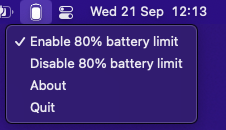

# Battery: charge limiter for Apple Silicon MacBooks

Keeps a plugged-in MacBook at `80%` (or any limit you pick) to slow battery ageing. Native Swift menu bar app, free and open source. **v2 is a full rewrite**; the old Electron + shell version lives in [`legacy/`](./legacy).

> Does this do anything? [BU-808](https://batteryuniversity.com/article/bu-808-how-to-prolong-lithium-based-batteries): keep it cool, ~80% when plugged in, discharge shallowly.

## Requirements

Apple Silicon, **macOS 14+**. Intel Macs: use [AlDente](https://apphousekitchen.com/).

## Install

| How | |
| --- | --- |
| DMG | [Releases](https://github.com/actuallymentor/battery/releases), drag `Battery.app` to `/Applications` |
| Homebrew | `brew install --cask battery` (once a signed release exists) |

First launch: **Enable helper** → approve *Battery* in *System Settings → General → Login Items & Extensions*. One time, no password prompts afterwards. Coming from v1? Battery offers to remove the old install.

## Use

Menu bar icon: charge limit toggle, presets (`60 70 80 90`, right-click to remove, `…` to add your own), slider, *Resume below* (hysteresis), optional *discharge down to the limit*, one-off *Charge to 100%* / *Discharge to* / *Calibrate*.
Settings: open at login, menu bar % and icon, low-battery alert, scheduled top-off every N days, opt-in updates, `battery` in Terminal, uninstall.

## CLI

*Settings → Use `battery` in Terminal* links it to `/usr/local/bin/battery` (app must be in `/Applications`). No sudo, ever: it is a thin client of the root helper.

```
battery status | status_csv
battery maintain 80 | 70-80 | 11.4V [0.1V] [--force-discharge] | stop | recover
battery charge 90 | discharge 50 | calibrate
battery charging on|off | adapter on|off
battery schedule 30          # top off to 100% every 30 days, 0 = off
battery logs 100 | version | uninstall
```

`maintain 70-80`: plugged in inside the band **holds**; charging resumes only below 70 and runs to 80.

## How it limits charging

Picked per Mac by **probing SMC keys, not OS versions** (Apple moved them across 15.8.x / 26.x / 27):

| Backend | Keys | Notes |
| --- | --- | --- |
| SMC inhibit | `CHTE` or `CH0B`/`CH0C` | helper loop + plug/wake events |
| Firmware limit | `bfD0` `bfE0` `bfF0` | firmware enforces it, also asleep. Floor 20% |
| Adapter cut | `CHIE` / `CH0J` / `CH0I` | compatibility mode, uses battery |
| none | | UI says so. It never pretends |

The helper verifies the hardware actually obeys and warns if the Mac keeps charging. macOS 27's native charge limit is not wired up yet. Interplay with Apple's *Optimized Battery Charging*: leave it on or off, but not both a native limit and this at once.

## Privacy and security

- No telemetry, no network calls. Updates (Sparkle 2, EdDSA-signed) only if you turn them on.
- Root helper = `SMAppService` daemon in the app bundle; XPC peers must be signed by team `CAWM399GFD`; fixed command surface, no sudoers, no shell.

## Develop

```
cd macos && swift test                    # core logic, runs anywhere
cd macos && xcodegen && xcodebuild -scheme Battery build
scripts/release/                          # CI release pipeline (tag v* -> signed, notarized dmg + pkg)
```

Layout: `macos/Sources/BatteryCore` (pure logic), `App/` SwiftUI, `Daemon/` root helper + SMC, `CLI/`, `Shared/` XPC. Ad-hoc dev builds invalidate the `SMAppService` approval on every rebuild; load the daemon with a plain launchd plist while iterating.

## FAQ

**Not working on my Mac?** Settings → Helper shows the charge-control backend and the SMC keys found; `battery logs 100` shows what the helper did. Open an issue with both.

**vs Optimized Charging?** That's ML-timed and per-Apple. This is explicit: you choose the limit.

Support: PRs welcome ([help wanted](https://github.com/actuallymentor/battery/labels/help%20wanted%20%28PR%20welcome%29)), issues, or [a tweet](https://twitter.com/actuallymentor).
